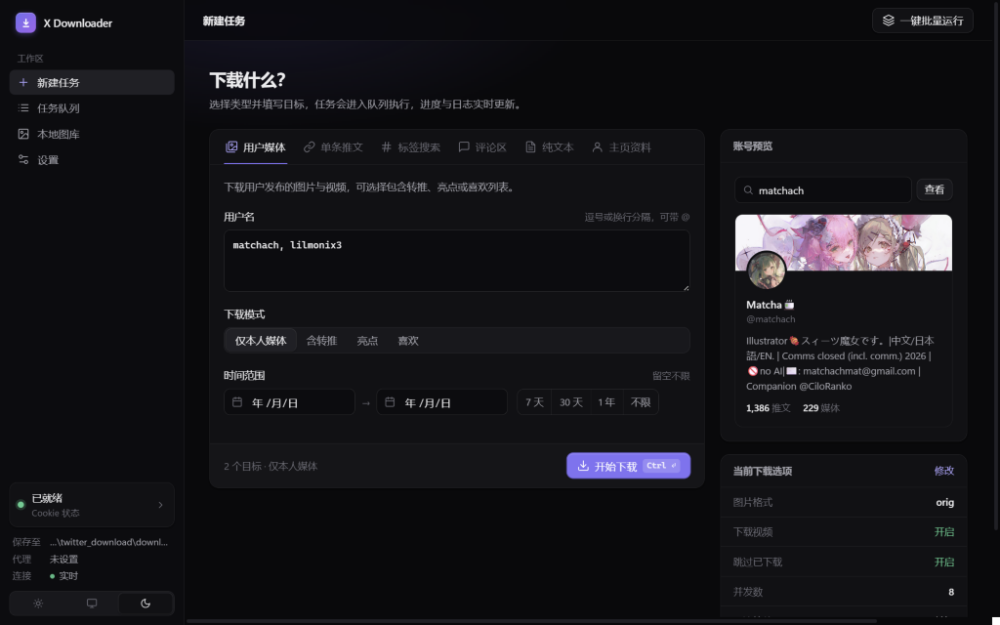
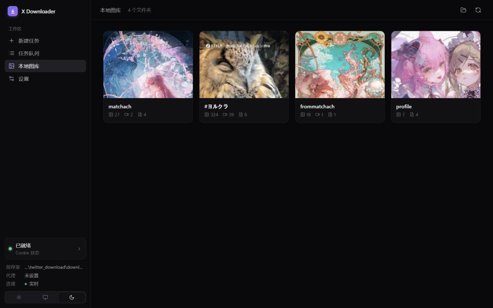

# Twitter_Downloader &nbsp; (๑¯◡¯๑)

**中文** | [English](README_EN.md)

Twitter / X 图片 & 视频(含 GIF) & 文本 & 评论区 & 主页资料下载工具。

支持：**本地 WebUI 图形界面**、**CLI 命令行 & 批量运行**、用户媒体/转推/亮点/喜欢、**单条推文快速下载**、按 Tag/高级搜索、评论区、纯文本导出、主页资料、自动断点去重与限流等待。

---

## Disclaimer / 免责声明

> **EN**
>
> 1. This project is intended for programming learning, academic research, and personal practice.
> 2. The rights to all media content (images, videos, etc.) downloaded using this tool remain with their respective rightsholders. Please respect relevant copyrights.
> 3. Users must comply with applicable laws, the target platform's Terms of Service, and relevant copyright regulations. Do not use this tool for malicious scraping, copyright infringement, illegal distribution, or other unlawful activities.

> **ZH**
>
> 1. 本项目主要用于编程学习交流、学术研究及个人练习。
> 2. 使用本工具下载的所有媒体内容（图片、视频等）的相关权利均归各自权利人所有，请尊重相关版权。
> 3. 使用者须遵守适用法律、目标平台的服务条款及相关版权规定。请勿将本工具及所获取的数据用于恶意抓取、侵权传播或其他违法用途。

---

**API 限流说明**
```text
当程序提示 HTTP 429 / API 调用次数已超限：
- 开启 advanced.wait_on_rate_limit = true 可自动等待至 x-rate-limit-reset 重置后继续
- 仅下载本人媒体 (mode = "media") 调用次数最少；包含转推或纯文本模式消耗较多
- 图片/视频文件下载本身不计入 GraphQL API 次数
```

---

# Change Log

* **2026-11-24**
  * 新增本地 WebUI（双击 `start_webui.bat` 或运行 `python webui.py`），支持任务队列、本地图库与可视化设置
  * 重构异步下载核心并精简 `settings.json`，新增单条推文直下、Netscape `cookies.txt` 与 SOCKS5 代理支持
  * 修复 `X-Client-Transaction-ID` 失效、编辑推文漏抓等 Bug，兼容 Twitter 新旧 GraphQL 字段
* **2025-08-09**
  * 支持获取用户主页内容（头像 & banner & 简介）
* **2025-04-26**
  * 替换部分失效接口，增加 `X-Client-Transaction-ID` 校验（Reference: `https://github.com/iSarabjitDhiman/XClientTransaction`）
* **2025-03-03**
  * 支持下载评论区（指定用户或推文链接）
* **2024-05-24**
  * 按 Tag 获取支持保存文本内容
* **2024-05-11**
  * 支持获取纯文本推文
* **2024-05-10**
  * 支持按 Tag 与高级搜索获取
* **2024-03-09**
  * 支持记录已下载内容、自动同步最新内容
* **2024-01-16**
  * 适配喜欢 (Likes) 标签页
* **2024-01-05**
  * 适配亮点 (Highlights) 标签页

---

<div align="center">

|  |
|:--:|
| **(๑´ڡ`๑)** |

</div>

---

## 快速开始

### 1. 安装依赖（Python >= 3.10）

```bash
git clone https://github.com/caolvchong-top/twitter_download.git
cd twitter_download
pip install -r requirements.txt
```

> 从旧版本更新的用户请重新执行 `pip install -r requirements.txt`；旧版 `settings.json` 与 `cache_data.log` 均自动兼容。

### 2. 获取 Cookie

支持两种方式（任选其一，**[查看详细图文教程](docs/cookie_guide.md)**）：
* **推荐**：用浏览器插件（如 `Get cookies.txt LOCALLY`）导出 Netscape 格式 `cookies.txt`，放到项目根目录或在 WebUI「设置」页直接上传；
* **手动**：按 `F12` 复制 `x.com` 下的 `auth_token` 和 `ct0`，按 `auth_token=xxx; ct0=xxx;` 填入 WebUI 设置或 `settings.json`。

### 3. 运行程序

#### 方式一：WebUI 图形界面（推荐）

* **Windows 用户**：直接双击根目录下的 **`start_webui.bat`** 即可（自动检测 Python >= 3.10、缺依赖自动安装，并自动打开浏览器）。
* **命令行 / macOS / Linux 启动**：

```bash
python webui.py                       # 启动后自动打开 http://127.0.0.1:7860
python webui.py --port 8080 --no-browser
python webui.py --max-parallel 2      # 同时运行 2 个任务（默认 1，降低限流风险）
```

* 支持 6 种下载类型（用户媒体 / 单条推文 / 标签搜索 / 评论区 / 纯文本 / 主页资料）、账号预览、SSE 实时进度队列、本地图库灯箱与可视化设置。
* 高级搜索条件可直接前往 [推特高级搜索](https://x.com/search-advanced) 页面拼装后`直接复制搜索栏内容`。
* WebUI 仅监听本机 `127.0.0.1`；图库缩略图缓存可在「设置 → 存储与缓存」中一键清理（不删原图/视频）。

#### 方式二：命令行 / 批量运行（适合服务器 / 批处理）

```bash
# 直接按 settings.json 批量运行
python main.py

# 下载指定用户媒体（mode 可选: media / retweet / highlights / likes）
python main.py user matchach lilmonix3 --mode media --time-range 2025-01-01:2026-12-31

# 下载单条或多条推文的原图/视频
python main.py tweet https://x.com/matchach/status/1855589540905590962

# 按标签 / 高级搜索下载（type 可选: media / media_latest / text）
python main.py search "#ヨルクラ" --type media --limit 100

# 下载推文或用户评论区（加 --no-media 可仅导文本）
python main.py reply https://x.com/matchach/status/1855589540905590962

# 下载用户纯文本推文
python main.py text yorukura_anime --retweet

# 下载用户头像 / Banner / 简介
python main.py profile matchach lilmonix3
```

> 兼容提示：原有的 `tag_down.py`、`reply_down.py`、`text_down.py`、`profile_down.py` 均已保留为轻薄兼容入口，老习惯仍可直接运行。

---

## `settings.json` 配置说明（使用 WebUI 可跳过，直接在网页「设置」中修改）

新版配置拆分为**基础 4 项 + 可选高级项**（兼容旧版 `settings.json`）：

```json
{
    "cookie": "cookies.txt",
    "users": ["lilmonix3", "matchach"],
    "mode": "media",
    "save_path": "",
    "advanced": {
        "time_range": "",
        "has_video": true,
        "image_format": "orig",
        "skip_downloaded": true,
        "md_output": false,
        "media_count_limit": 350,
        "concurrency": 8,
        "proxy": "",
        "wait_on_rate_limit": false,
        "log_output": false
    }
}
```

| 字段 | 说明 | 默认值 |
| :--- | :--- | :--- |
| `cookie` | Netscape 格式文件路径（如 `cookies.txt`）或 `auth_token=...; ct0=...;` 字符串 | `"cookies.txt"` |
| `users` | 批量下载的目标用户名列表（不含 `@`） | `["lilmonix3", "matchach"]` |
| `mode` | 下载模式：`media`（仅本人媒体）/ `retweet`（含转推）/ `highlights`（亮点）/ `likes`（喜欢，仅限本人账号） | `"media"` |
| `save_path` | 保存根目录，留空为当前目录 | `""` |
| `advanced.time_range` | 时间范围，如 `"2024-01-01:2026-12-31"`，留空不限 | `""` |
| `advanced.has_video` | 是否下载视频与 GIF | `true` |
| `advanced.image_format` | 图片格式：`orig`（自适应原图，最快最省空间）/ `jpg` / `png` | `"orig"` |
| `advanced.skip_downloaded` | 自动跳过已下载文件（实时增量日志 + 本地文件去重，兼容旧 `cache_data.log`） | `true` |
| `advanced.md_output` | 是否同时生成 Markdown 归档文件 | `false` |
| `advanced.media_count_limit` | 单个 Markdown 文件包含的最大媒体数量，`0` 为不限制 | `350` |
| `advanced.concurrency` | 最大并发下载数 | `8` |
| `advanced.proxy` | 代理地址（如 `http://127.0.0.1:7890` 或 `socks5://127.0.0.1:10808`）；已开 VPN / 系统代理通常留空即可 | `""` |
| `advanced.wait_on_rate_limit` | 遇到 HTTP 429 限流时是否自动按 `x-rate-limit-reset` 等待重置后继续 | `false` |
| `advanced.log_output` | 是否逐条打印单文件下载日志 | `false` |

---

## 效果预览






