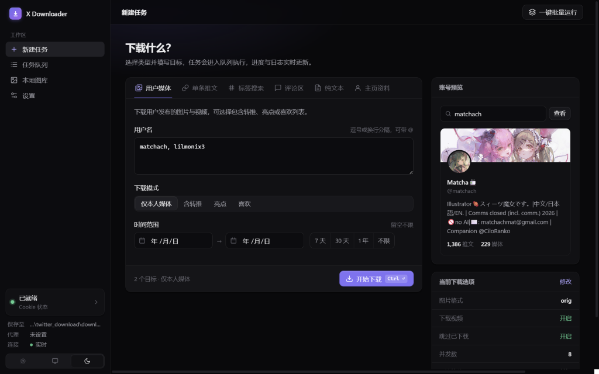
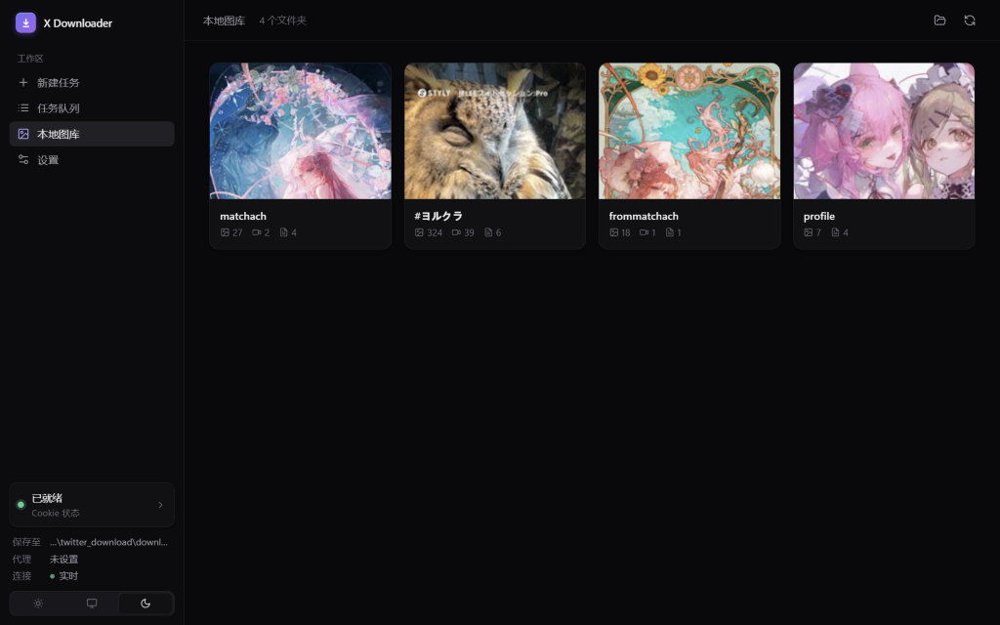

# Twitter_Downloader &nbsp; (๑¯◡¯๑)

[中文](README.md) | **English**

Download images, videos (including GIFs), text tweets, replies, and user profiles from Twitter / X.

Supports: **Local WebUI**, **CLI & Batch Mode**, user media / retweets / highlights / likes, **single-tweet quick download**, hashtag / advanced search, reply threads, text CSV export, user profiles, crash-safe deduplication, and automatic rate-limit waiting.

---

## Disclaimer

> 1. This project is intended for programming learning, academic research, and personal practice.
> 2. The rights to all media content (images, videos, etc.) downloaded using this tool remain with their respective rightsholders. Please respect relevant copyrights.
> 3. Users must comply with applicable laws, the target platform's Terms of Service, and relevant copyright regulations. Do not use this tool for malicious scraping, copyright infringement, illegal distribution, or other unlawful activities.

---

**API Rate Limit Notes**
```text
When HTTP 429 / Rate limit exceeded occurs:
- Set advanced.wait_on_rate_limit = true to automatically wait until x-rate-limit-reset and resume
- User media only (mode = "media") uses the fewest API calls; retweets and text mode use more
- Downloading image/video files does not count toward GraphQL API limits
```

---

# Change Log

* **2026-11-24**
  * Added local WebUI (double-click `start_webui.bat` or run `python webui.py`) with task queue, local gallery, and visual settings
  * Refactored async core engine & simplified `settings.json`; added single-tweet download, Netscape `cookies.txt`, and SOCKS5 proxy support
  * Fixed `X-Client-Transaction-ID` generation, edited-tweet skipping, and GraphQL schema compatibility
* **2025-08-09**
  * Added user profile download (avatar, banner, and bio)
* **2025-04-26**
  * Updated deprecated endpoints and added `X-Client-Transaction-ID` verification (Reference: `https://github.com/iSarabjitDhiman/XClientTransaction`)
* **2025-03-03**
  * Added reply thread downloader (by user or tweet URL)
* **2024-05-24**
  * Added text saving support for hashtag search
* **2024-05-11**
  * Added plain-text tweet downloader
* **2024-05-10**
  * Added hashtag & advanced search downloader
* **2024-03-09**
  * Added download deduplication cache & auto-sync
* **2024-01-16**
  * Added Likes tab support
* **2024-01-05**
  * Added Highlights tab support

---

<div align="center">

|  |
|:--:|
| **(๑´ڡ`๑)** |

</div>

---

## Quick Start

### 1. Install Dependencies (Python >= 3.10)

```bash
git clone https://github.com/caolvchong-top/twitter_download.git
cd twitter_download
pip install -r requirements.txt
```

> Upgrading from an older version? Re-run `pip install -r requirements.txt`. Existing `settings.json` and `cache_data.log` files remain compatible.

### 2. Get Your Cookie

Choose either method (**[See Illustrated Step-by-Step Guide](docs/cookie_guide.md#cookie-setup-guide)**):
* **Recommended**: Export a Netscape-format `cookies.txt` using a browser extension (e.g., `Get cookies.txt LOCALLY`), then drop it in the project root or upload it in the WebUI Settings page.
* **Manual**: Press `F12`, copy `auth_token` and `ct0` under `https://x.com`, and paste `auth_token=xxx; ct0=xxx;` into WebUI Settings or `settings.json`.

### 3. Run

#### Option 1: Local WebUI (Recommended)

* **Windows**: Double-click **`start_webui.bat`** in the project root (automatically detects Python >= 3.10, installs missing dependencies on first run, and opens your browser).
* **Terminal / macOS / Linux**:

```bash
python webui.py                       # Opens http://127.0.0.1:7860 automatically
python webui.py --port 8080 --no-browser
python webui.py --max-parallel 2      # Run 2 jobs concurrently (default 1 to avoid rate limits)
```

* Supports all 6 task types (User Media / Single Tweet / Tag & Search / Replies / Plain Text / Profile), live account preview, real-time SSE task queue, local gallery with lightbox, and visual settings.
* For advanced search filters, build your query at [X Advanced Search](https://x.com/search-advanced) and copy the search bar text.
* WebUI binds strictly to `127.0.0.1` (localhost only). Gallery thumbnail cache can be cleared anytime from **Settings → Storage & Cache** without deleting downloaded media.

#### Option 2: CLI / Batch Mode (Great for Servers & Automation)

```bash
# Run batch download directly from settings.json
python main.py

# Download user media (mode: media / retweet / highlights / likes)
python main.py user matchach lilmonix3 --mode media --time-range 2025-01-01:2026-12-31

# Download media from one or more tweet URLs
python main.py tweet https://x.com/matchach/status/1855589540905590962

# Search by hashtag or advanced query (type: media / media_latest / text)
python main.py search "#ヨルクラ" --type media --limit 100

# Download replies for a tweet URL or @username (add --no-media for CSV only)
python main.py reply https://x.com/matchach/status/1855589540905590962

# Export plain-text tweets to CSV
python main.py text yorukura_anime --retweet

# Download user avatar, banner, and bio
python main.py profile matchach lilmonix3
```

> Legacy scripts (`tag_down.py`, `reply_down.py`, `text_down.py`, `profile_down.py`) are preserved as thin wrappers for backward compatibility.

---

## `settings.json` Reference (Skip if using WebUI — edit directly in Settings)

Simplified into **4 core fields + optional `advanced` settings** (backward-compatible with older `settings.json` files):

```json
{
    "cookie": "cookies.txt",
    "users": ["lilmonix3", "matchach"],
    "mode": "media",
    "save_path": "",
    "advanced": {
        "time_range": "",
        "has_video": true,
        "image_format": "orig",
        "skip_downloaded": true,
        "md_output": false,
        "media_count_limit": 350,
        "concurrency": 8,
        "proxy": "",
        "wait_on_rate_limit": false,
        "log_output": false
    }
}
```

| Field | Description | Default |
| :--- | :--- | :--- |
| `cookie` | Path to Netscape `cookies.txt` or `auth_token=...; ct0=...;` string | `"cookies.txt"` |
| `users` | Target usernames for batch download (without `@`) | `["lilmonix3", "matchach"]` |
| `mode` | `media` (own media) / `retweet` (with retweets) / `highlights` / `likes` (own account only) | `"media"` |
| `save_path` | Output root folder (empty = current directory) | `""` |
| `advanced.time_range` | Date range `YYYY-MM-DD:YYYY-MM-DD` (empty = unlimited) | `""` |
| `advanced.has_video` | Download videos and GIFs | `true` |
| `advanced.image_format` | `orig` (original quality & fastest) / `jpg` / `png` | `"orig"` |
| `advanced.skip_downloaded` | Skip already-downloaded files (incremental log + existing file check) | `true` |
| `advanced.md_output` | Also generate Markdown archive files | `false` |
| `advanced.media_count_limit` | Max media items per Markdown file (`0` = unlimited) | `350` |
| `advanced.concurrency` | Max concurrent file downloads | `8` |
| `advanced.proxy` | Proxy URL (`http://127.0.0.1:7890` or `socks5://127.0.0.1:10808`); leave empty if VPN / system proxy is active | `""` |
| `advanced.wait_on_rate_limit` | Automatically wait for `x-rate-limit-reset` on HTTP 429 | `false` |
| `advanced.log_output` | Print per-file download logs | `false` |

---

## Preview






