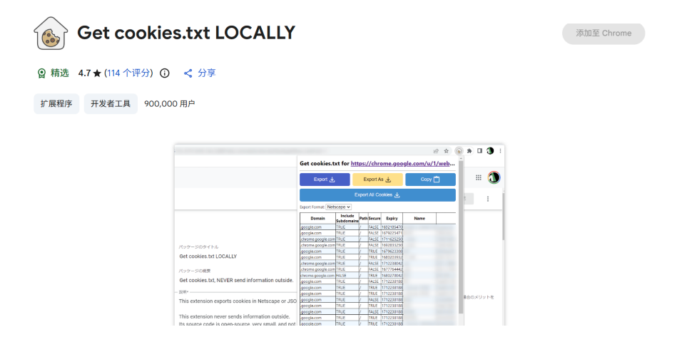
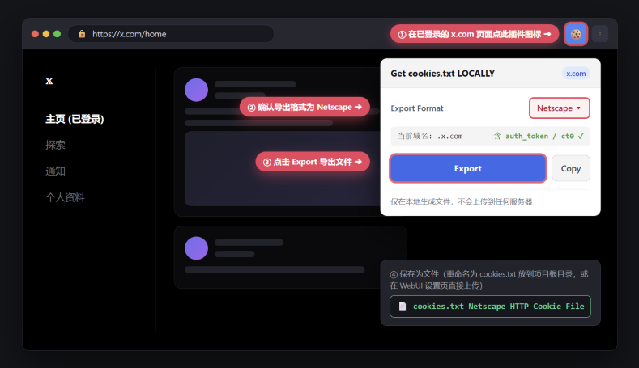
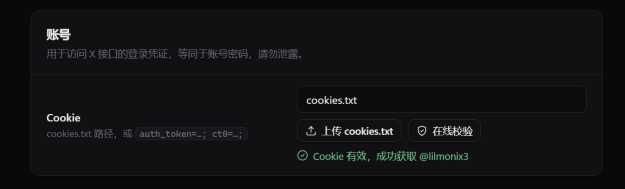
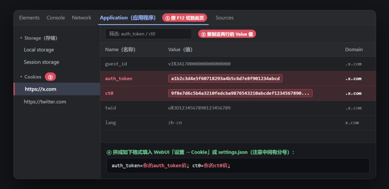

# Cookie 获取与导入教程

**中文** | [English](#cookie-setup-guide)

本工具通过你登录后的浏览器 Cookie（核心字段为 `auth_token` 和 `ct0`）访问 X / Twitter 接口。提供 **插件导出 `cookies.txt`（推荐）** 和 **浏览器 F12 手动复制** 两种方式，任选其一即可。

> **安全提醒**：Cookie 等同于账号登录凭证，**切勿分享给他人或上传到公开仓库**。如果后续提示 `HTTP 401/403`（登录失效），重新登录 `https://x.com` 按本教程再导出覆盖即可。

---

## 方式一：浏览器插件一键导出 `cookies.txt`（推荐）

### 第 1 步：安装浏览器插件

在浏览器扩展商店安装任意一款支持导出 **Netscape HTTP Cookie File** 格式的本地插件（推荐开源、无云端上传）：

* **Chrome / Edge**：搜索安装 **Get cookies.txt LOCALLY**（[Chrome 应用商店直达链接](https://chromewebstore.google.com/detail/get-cookiestxt-locally/cclelndahbckbenkjhflpdbgdldlbecc)，认准下方「房子+饼干」图标与精选标记）
* **Firefox**：附加组件商店搜索安装 **cookies.txt** 或 **Export Cookies**



### 第 2 步：登录 X 并导出文件

1. 在浏览器打开 `https://x.com` 并登录你的账号；
2. 点击浏览器右上角插件图标；
3. 确认导出格式为 **Netscape**，点击 **Export**，将文件保存为 `cookies.txt`。



### 第 3 步：导入工具（二选一）

* **使用 WebUI（最省心）**：
  1. 双击 `start_webui.bat`（或运行 `python webui.py`）打开网页；
  2. 点击左侧 **设置** → 在「账号」卡片中点击 **上传 cookies.txt** 选择刚导出的文件；
  3. 点击 **在线校验**，看到绿色提示 `Cookie 有效` 即配置完成。



* **使用命令行**：直接把 `cookies.txt` 放到本项目根目录（与 `main.py` 同级）即可，程序会自动识别读取；如果文件名不同，在 `settings.json` 的 `"cookie"` 字段填入对应文件路径即可。

---

## 方式二：浏览器 F12 手动复制 `auth_token` 与 `ct0`

如果不想安装浏览器插件，可以直接手动提取两个核心字段：

1. 在浏览器打开并登录 `https://x.com`；
2. 按键盘 `F12` 打开开发者工具，顶部切到 **Application（应用程序）** 标签（Firefox 为 **存储 / Storage**）；
3. 左侧展开 **Cookies** → 点击 `https://x.com`；
4. 在右侧表格中找到 `auth_token` 和 `ct0` 两行，分别双击复制它们的 **Value（值）**；
5. 按下方格式拼接（注意两项之间的英文分号）：

```text
auth_token=你的auth_token值; ct0=你的ct0值;
```



6. 将拼好的字符串粘贴到 WebUI **「设置 → Cookie」**（点「在线校验」确认有效后点右上角「保存」），或直接填入 `settings.json` 的 `"cookie"` 字段即可。

---

## 常见问题

* **提示“缺少 auth_token 或 ct0 字段”**：请确认是在**已经登录**的 `https://x.com` 页面点击的导出，而不是未登录页或其他网站。
* **在线校验超时 / 连接失败**：国内网络若开了 VPN 或系统代理，WebUI 设置中的「代理」留空即可；如果留空依然连不上，请填入代理软件实际监听的地址（支持 `http://` 和 `socks5://`）。
* **出现 HTTP 401 / 403**：Cookie 已过期或账号在网页端退出登录，重新登录 `x.com` 导出替换即可。

---

## Cookie Setup Guide

[返回中文](#cookie-获取与导入教程) | [Back to README (EN)](../README_EN.md)

This tool authenticates with X / Twitter using your logged-in browser cookies (`auth_token` and `ct0`). You can either **export a Netscape `cookies.txt` file via a browser extension (recommended)** or **copy the two fields manually from DevTools (F12)**.

> **Security Warning**: Your cookies grant full access to your X account. **Never share `cookies.txt` or commit it to a public repository.** If you later see `HTTP 401/403`, simply log in to `https://x.com` again and re-export.

### Method 1: Export `cookies.txt` via Browser Extension (Recommended)

#### Step 1: Install a Local Cookie Extension

Install an open-source, local-only extension that supports **Netscape HTTP Cookie File** export:

* **Chrome / Edge**: Install **Get cookies.txt LOCALLY** ([Chrome Web Store link](https://chromewebstore.google.com/detail/get-cookiestxt-locally/cclelndahbckbenkjhflpdbgdldlbecc) — look for the house + cookie icon and the Featured badge below)
* **Firefox**: Search for **cookies.txt** or **Export Cookies** on Firefox Add-ons


#### Step 2: Log in to X and Export

1. Open `https://x.com` in your browser and sign in;
2. Click the extension icon in the top-right browser toolbar;
3. Make sure the export format is set to **Netscape**, then click **Export** and save the file as `cookies.txt`.


#### Step 3: Import into the Tool

* **Using WebUI (Easiest)**:
  1. Double-click `start_webui.bat` (or run `python webui.py`) to open the web interface;
  2. Go to **Settings (设置)** → under the Account card, click **Upload cookies.txt (上传 cookies.txt)** and pick the exported file;
  3. Click **Verify Online (在线校验)** — once you see the green `Cookie 有效` confirmation, you're all set.


* **Using CLI**: Simply place `cookies.txt` in the project root directory (next to `main.py`) and it will be detected automatically. If you use a different filename or path, set `"cookie"` in `settings.json` accordingly.

### Method 2: Copy `auth_token` and `ct0` Manually via DevTools (F12)

If you prefer not to install a browser extension:

1. Open and sign in to `https://x.com`;
2. Press `F12` to open DevTools and switch to the **Application** tab (or **Storage** in Firefox);
3. Expand **Cookies** in the left sidebar and select `https://x.com`;
4. Find the `auth_token` and `ct0` rows and copy both **Value** fields;
5. Format them as follows (keep the semicolon between them):

```text
auth_token=YOUR_AUTH_TOKEN; ct0=YOUR_CT0;
```


6. Paste the string into WebUI **Settings → Cookie** (verify and click Save), or put it into the `"cookie"` field in `settings.json`.

### Troubleshooting

* **Missing `auth_token` or `ct0`**: Make sure you exported while signed in on `https://x.com` (not a logged-out page or another site).
* **Connection / Verification Timeout**: If you already have a VPN or system proxy enabled, leave the Proxy field empty. Only enter an explicit proxy (`http://...` or `socks5://...`) if direct/system proxy fails.
* **HTTP 401 / 403**: Your session expired or you logged out in the browser — sign in to `x.com` again and re-export `cookies.txt`.
